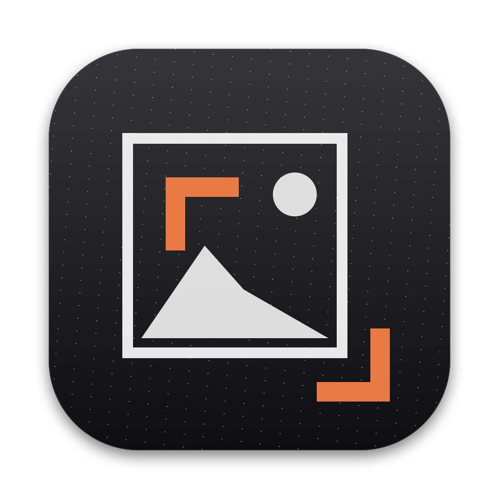
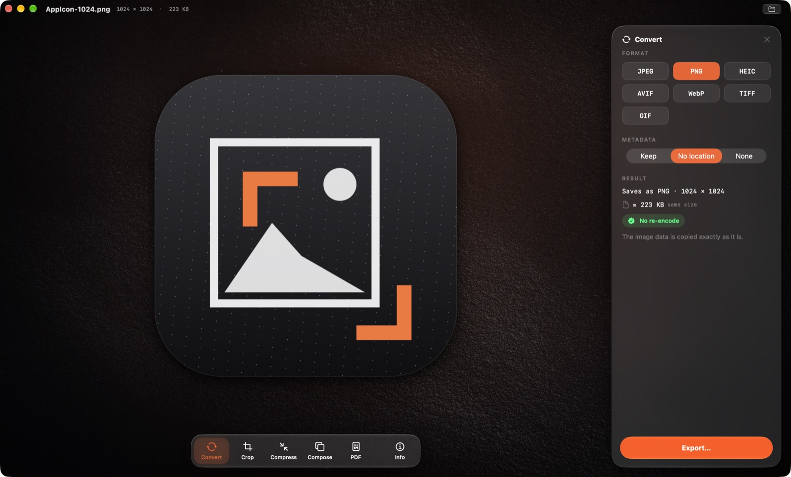

<p align="center"></p>

# DEX

**Take any image or sound and quickly turn it into what you need.** DEX is a small, native Mac app (a Windows version is being built in [`windows/`](windows/)) for converting, cropping, compressing and combining images, working with PDFs, and trimming and converting audio. It keeps quality whenever that's possible and tells you plainly when it isn't.

<p align="center"></p>

## What it does

| Tool | What you can do |
|---|---|
| **Convert** | JPEG, PNG, HEIC, WebP, AVIF, TIFF, GIF, in any direction. HDR photos stay HDR where the format allows. Location data is removed by default |
| **Crop** | Crop, rotate and flip, with aspect presets and a pixel-level zoom while you drag. JPEG crops are lossless |
| **Compress** | Lossless or smaller-file compression, smaller dimensions (4K / web / social), and the real resulting size shown before you save |
| **Compose** | Put images on top of each other (logos, watermarks) or join them side by side, stacked or in a grid, in any mix of formats |
| **PDF** | Make PDFs from images; turn PDF pages into images; rearrange, rotate, delete, extract, merge, split, add text or images to, and compress PDFs |
| **Audio** | Trim on a zoomable waveform, play it back, and save as WAV, AIFF, FLAC, ALAC, AAC or MP3. Trimming an MP3, AAC or ALAC doesn't re-encode it, and is still exact to the sample. Show and change the cover art, title and artist. Paste a YouTube link and choose on the next page: audio (AAC exactly as streamed, MP3, FLAC, ALAC, WAV, AIFF) or **video** in any quality up to 4K/8K, saved as MP4 without re-encoding |

You can also right-click images in Finder: **Services → DEX ▸ Convert to JPEG / PNG / HEIC / WebP, Combine into PDF**.

## Requirements
- A Mac with Apple Silicon (M1 or newer)
- macOS 26 or later

## Install

### Option A: download the app (no Xcode needed)
1. Download **DEX.zip** from the [Releases page](https://github.com/vxkram/DEX/releases).
2. Double-click the zip, then drag **DEX.app** into your **Applications** folder.
3. Open it. The first time, macOS will say it can't verify the app, because it isn't notarised by Apple yet. To allow it:
   - open **System Settings → Privacy & Security**,
   - scroll down to the message about DEX, click **Open Anyway**, and confirm.

   You only need to do this once.

### Option B: build it yourself (needs Xcode)
1. Install **Xcode** from the Mac App Store (free, about 10 GB), open it once, then run:
   ```sh
   sudo xcode-select -s /Applications/Xcode.app
   ```
2. Install Homebrew from [brew.sh](https://brew.sh) if you don't have it, then:
   ```sh
   brew install xcodegen
   ```
3. Get the code and build:
   ```sh
   git clone https://github.com/vxkram/DEX.git
   cd DEX/mac
   make package
   ```
4. The app is in **mac/build/DEX.zip**. Unzip it and move DEX.app to Applications.

## Using it
1. **Drop an image, a PDF or an audio file** onto the window (or click **Choose File…**).
2. Pick a tool from the dock at the bottom: **Convert, Crop, Compress, Compose, PDF, Info** for images, or **Trim, Convert, Info** for audio (shortcuts ⌘1–⌘6).
   For audio: Space plays, I and O set the trim at the playhead, and ⌘+ / ⌘− zoom (or pinch, or ⌥-scroll).
   To get audio or video from YouTube, paste the link on the start screen or choose **File ▸ Download from Link…** (⇧⌘O), press **Continue**, choose **Audio** or **Video**, pick a format or quality and **Download**. It's saved to Downloads.
3. Check the **Result** in the panel. It shows the format, the size of the file you'll get, and whether anything is lost. If a file will be bigger than the original, tap **Why?** to see the reason.
4. Click **Export** (⌘E) and choose where to save. **Your original file is never changed or overwritten.**

## Ideas & feedback
Have an idea, found a bug, or want a format DEX doesn't handle yet? Post it in **[Discussions](https://github.com/vxkram/DEX/discussions)**: ideas go under *Ideas*, questions under *Q&A*. Upvote the ideas you want most; that decides what comes next.

## Privacy
Everything happens on your Mac, and DEX never uploads anything. The app itself has no network access. The one exception is **Download from Link**: a small helper inside the app fetches the downloader (yt-dlp, from its official GitHub release, checksum-verified) the first time you use it, and then fetches the audio or video you asked for. Nothing else goes online. Location data is removed from exported photos unless you choose **Metadata → Keep**.

## Credits
Built with libjpeg-turbo, libwebp, LAME (MP3, LGPL, shipped as its own replaceable library) and Apple's frameworks. Details and licences are in **DEX ▸ About DEX**. For developers, see [docs/DEVELOPMENT.md](docs/DEVELOPMENT.md).

## Licence
DEX is released under the [MIT Licence](LICENSE). The bundled third-party libraries keep their own licences ([docs/NOTICES.md](docs/NOTICES.md)).
